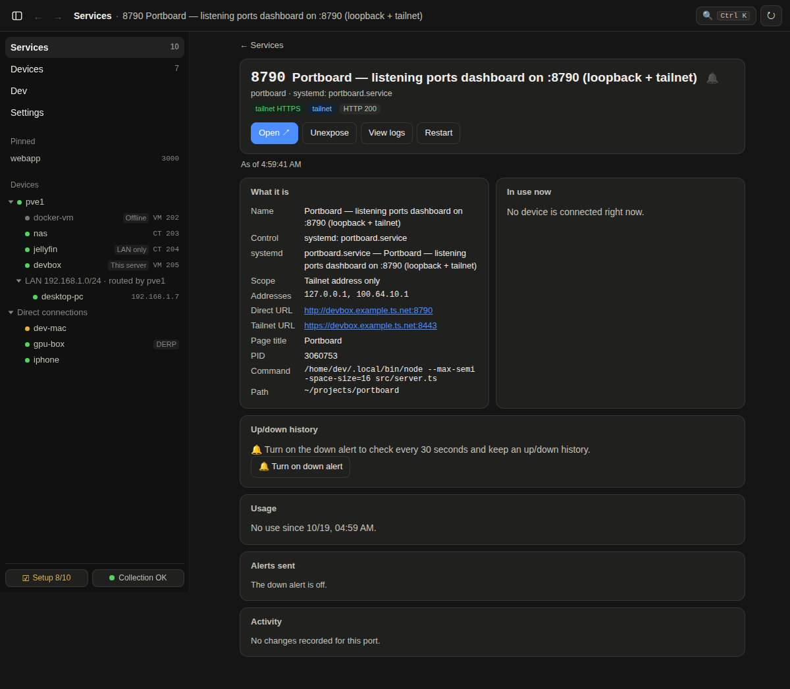

# Portboard

A dashboard of every TCP port listening on a Linux server, the devices on your Tailscale tailnet, and your dev
worktrees. Open any service from your laptop or phone with one click, no `ssh -N -L …` needed, and let Claude Code
pick ports and start dev servers through it instead of guessing.


- **Services.** Every listening port with its owner: process, project folder, systemd unit or docker container, HTTP
  title, bind scope (loopback / tailnet / all), who is connected now and when it was last used.
- **One click to open.** A loopback-only HTTP port can be published to the tailnet with `tailscale serve` from its row,
  and unpublished again.
- **Devices.** Tailnet devices with their load and the ports they use; optionally a Proxmox host and its containers and
  a desktop's Windows side, read over a read-only SSH key.
- **Dev servers and worktrees.** Start and stop a worktree's dev server, reserve stable ports per project, and find
  worktrees and servers that are safe to clean up.
- **Alerts.** Down alerts for watched ports and devices, new-device and new-port notices, daily or weekly digests, over
  ntfy or a webhook.
- **For AI agents.** A local MCP server, a Claude Code plugin with a port-picking skill and hooks, and an optional
  read-only remote MCP connector for claude.ai and ChatGPT.
- **Zero runtime dependencies.** Node.js and the standard library only. TypeScript runs directly on Node ≥ 22.18
  (type stripping); `typescript` and `@types/node` are dev dependencies for the typecheck.

The dashboard speaks **English and Korean**. It follows the browser's language unless the server sets one (`locale` in
`portboard.json` or `PORTBOARD_LOCALE`), and each device can pick its own under Settings › Display › Language
([docs/i18n](docs/i18n/README.md)). The code, docs and API are in English.

| Devices | A service's page, dark mode |
|---|---|
|  |  |

The screenshots use example data: none of these machines exist.

## Quick start

Requirements: Linux with `ss` (iproute2), Node.js ≥ 22.18 (24 recommended), and [Tailscale](https://tailscale.com)
for anything beyond `localhost`. systemd and docker are used when present.

```bash
git clone https://github.com/c10dev/portboard.git ~/projects/portboard
cd ~/projects/portboard
npm start                 # dashboard + REST API on 127.0.0.1:8790 and this machine's Tailscale IP
```

Open `http://127.0.0.1:8790`. From another tailnet device, publish it over HTTPS (tailnet only):

```bash
tailscale serve --bg --https=8443 http://127.0.0.1:8790
```

and open `https://<host>.<tailnet>.ts.net:8443`. Writes (stop, restart, publish, delete) work only through that HTTPS
address and only for your own Tailscale login; plain `http://<tailscale-ip>:8790` is read-only.

Run it as a systemd user service:

```bash
cp deploy/portboard.service ~/.config/systemd/user/   # check WorkingDirectory and the node path in ExecStart
systemctl --user daemon-reload
systemctl --user enable --now portboard
```

Nothing has to be configured: the host name, tailnet and user come from the machine. To name a Proxmox host, a Windows
desktop, other repo folders or a compute-pool monitor, copy [`portboard.example.json`](portboard.example.json) to
`~/.config/portboard/portboard.json` and edit it ([docs/config.md](docs/config.md)). More: [docs/setup.md](docs/setup.md).

## Security model

Portboard can stop services and delete worktrees, so read [docs/security.md](docs/security.md) before exposing it.
In short:

- **Reachable only from this machine and your tailnet.** It binds to loopback and the Tailscale IP, and answers 421 to
  any `Host` it doesn't recognise (DNS rebinding).
- **Owner-only writes.** Every write needs the `X-Portboard: 1` header (CSRF) and the owner: a local process, or your
  own Tailscale login through `tailscale serve`. Other tailnet users, tagged nodes, direct connections and Funnel
  traffic are read-only. `writeDevices` in `~/.config/portboard/access.json` narrows writes to the devices you list.
  Every write, allowed or denied, goes to an audit log.
- **Reads are open to the tailnet.** Anyone who can reach it sees port lists, command lines and device names. Share
  your tailnet accordingly.
- **The remote MCP server is read-only.** `src/remote.ts` (port 8794) is meant for Tailscale Funnel, so claude.ai and
  ChatGPT can ask what is running. It offers only read tools, with redacted addresses and paths, behind OAuth with a
  one-time approval code ([docs/remote-mcp](docs/remote-mcp/README.md), [review](docs/remote-mcp/SECURITY-REVIEW.md)).
  It is off unless you run it.
- **Never put the dashboard (8790 / its serve port) on Funnel**, never bind it to a public interface, and never commit
  `~/.config/portboard/` (it holds tokens and secrets).

Found a vulnerability? See [SECURITY.md](SECURITY.md).

## Claude Code plugin

This repository is also a Claude Code plugin marketplace. The `portboard` plugin adds the MCP server, a
`dev-servers-and-ports` skill, a hook that nudges when a Bash command hard-codes or kills a port, and session-end
cleanup of dev servers:

```
/plugin marketplace add c10dev/portboard
/plugin install portboard@portboard
```

The plugin runs the MCP server from your checkout (`~/projects/portboard`, or `PORTBOARD_HOME`). Details:
[docs/claude-plugin](docs/claude-plugin/README.md). Without the plugin: [docs/mcp.md](docs/mcp.md).

## Mac app

A native SwiftUI app (macOS 14+) shows the dashboard in a window, with a menu bar item and native notifications. Build
it on the Mac with your server's address:

```bash
PORTBOARD_SERVER_URL=https://<host>.<tailnet>.ts.net:8443 mac-app/build.sh --install
```

Details: [docs/mac-app](docs/mac-app/README.md).

## Docs

| Topic | |
|---|---|
| [Setup and running](docs/setup.md) | environment variables, previews, systemd, Mac app, one-time `tailscale serve` setup |
| [Site config](docs/config.md) | `portboard.json`: host, tailnet, repos, Proxmox and Windows readers, port rules |
| [Dashboard](docs/dashboard.md) | rows, last-used history, service page, devices, alerts, new devices |
| [REST API](docs/api.md) | endpoints and guards |
| [MCP servers](docs/mcp.md) | the local stdio server: tools, resources, prompts |
| [Remote MCP](docs/remote-mcp/README.md) | the read-only connector for claude.ai and ChatGPT |
| [Security](docs/security.md) | who can reach and write, audit log, headers and files |
| [Operations](docs/operations.md) | deploy, profiles, files, the SSH readers, runtime footprint |
| [Runbooks](docs/runbooks/README.md) | setting up and rotating every credential Portboard holds |
| [Architecture](docs/architecture.md) | source layout, adding a feature |
| [CHANGELOG.md](CHANGELOG.md) · [changelog.d](changelog.d/README.md) | releases, how to add an entry |

## Optional integrations

- **compute-pool**: a separate monitor (`cpool monitor`, `PORTBOARD_POOL_URL`) whose hosts the Devices tab shows with load
  and state. Without it the tab lists tailnet devices only. Any endpoint serving the same JSON works:
  [integrations/compute-pool.md](docs/integrations/compute-pool.md).
- **Proxmox VE**: an API token for VM/CT state and trends, and a forced-command SSH key for container ports
  ([runbooks](docs/runbooks/README.md)).
- **ntfy or a webhook** for alerts.

## Contributing

Issues and pull requests are welcome: [CONTRIBUTING.md](CONTRIBUTING.md). Please follow the
[Code of Conduct](CODE_OF_CONDUCT.md).

## License

[MIT](LICENSE)
