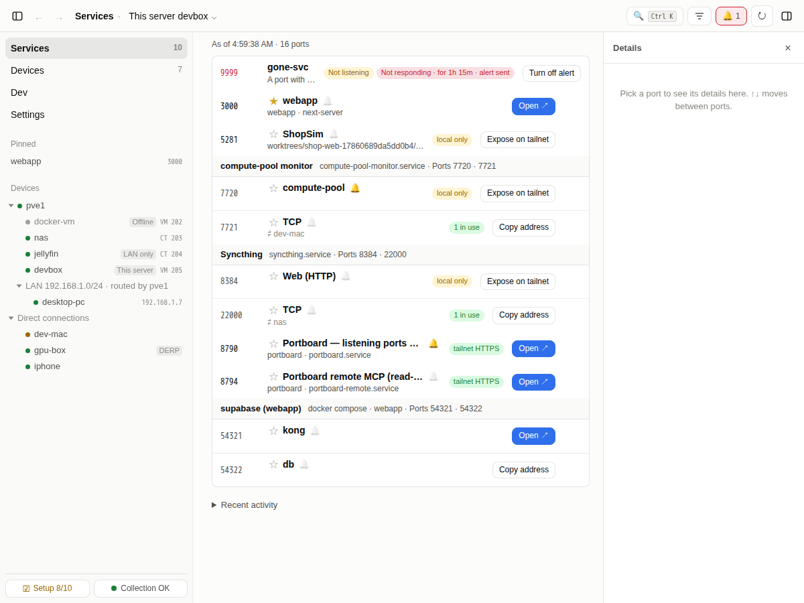
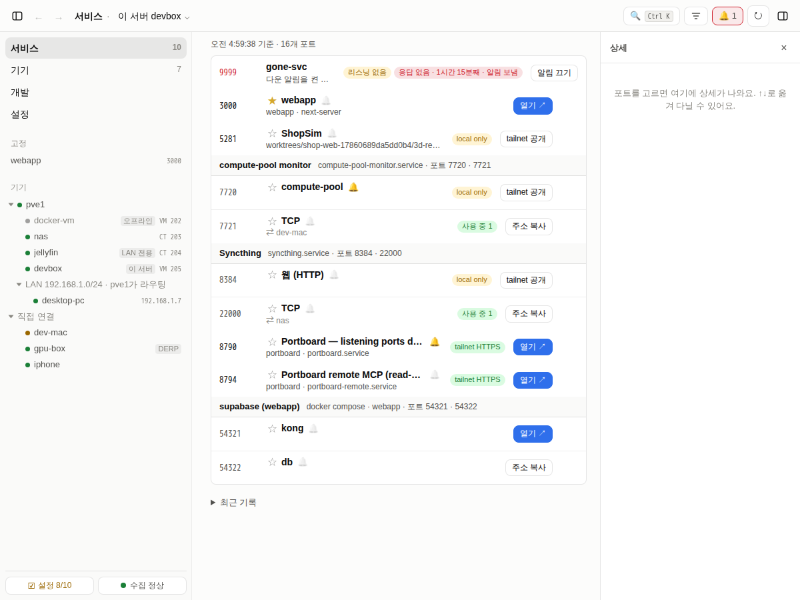
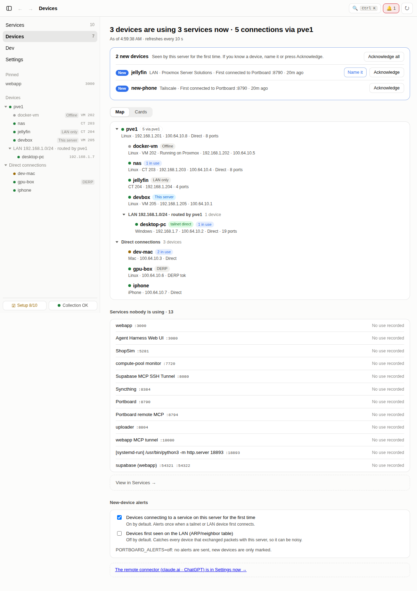
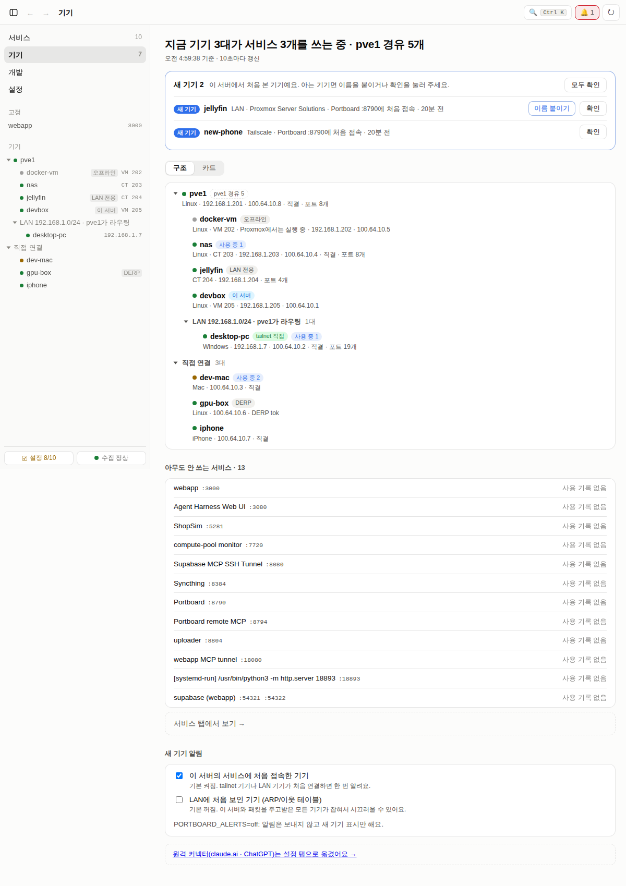
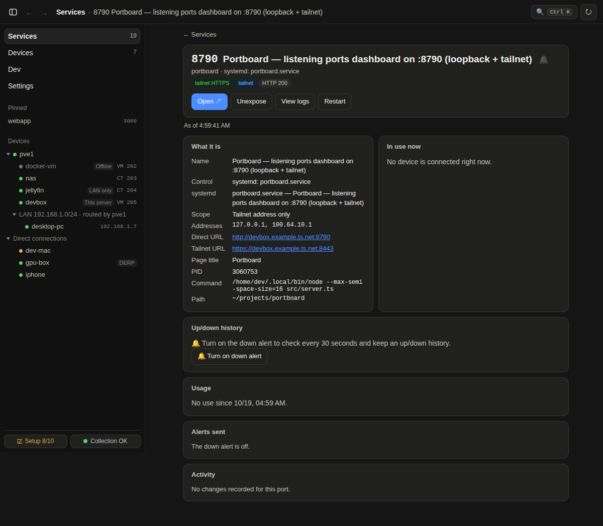
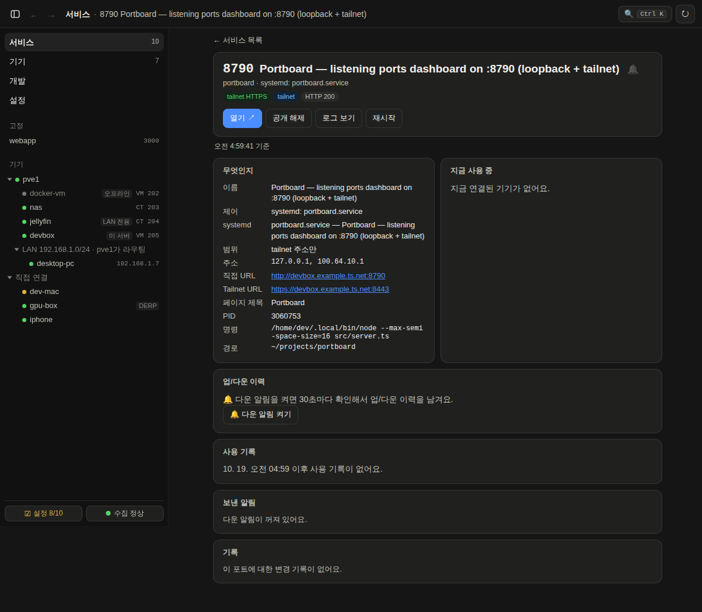
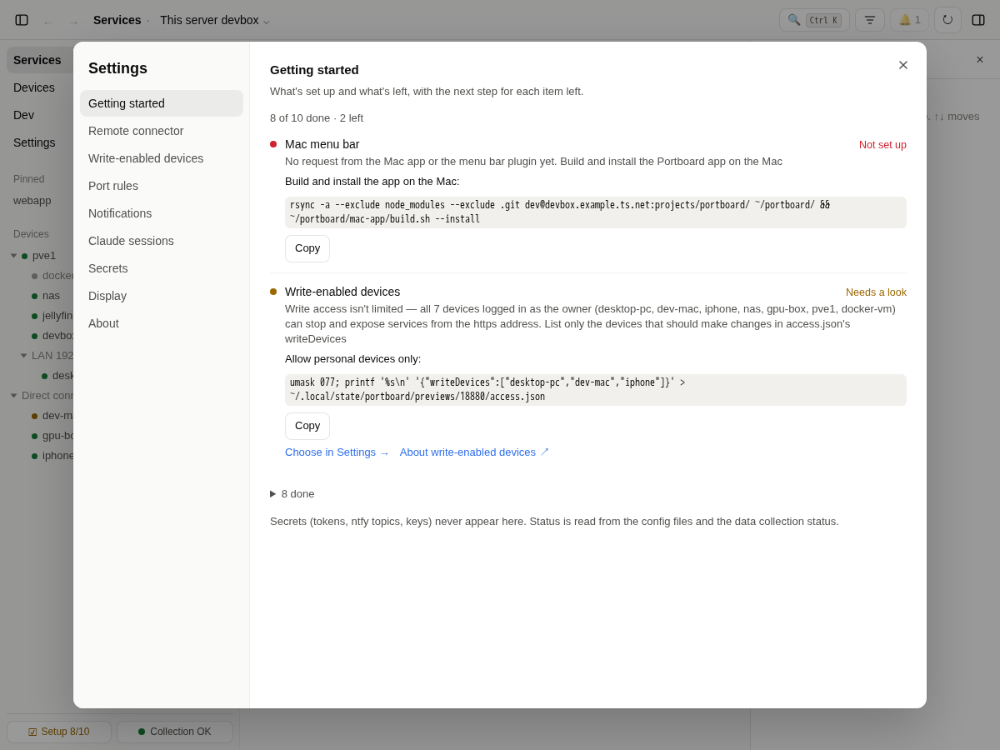
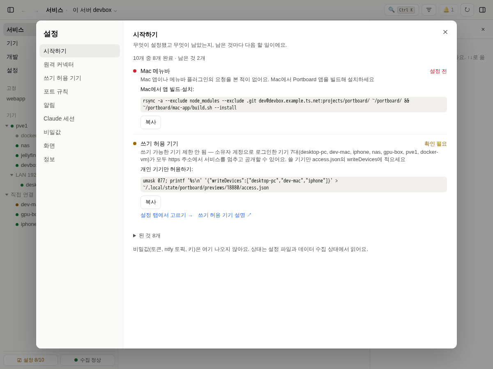
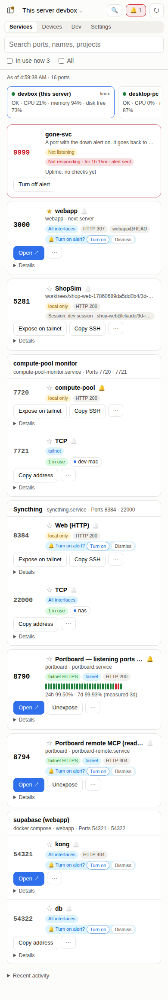
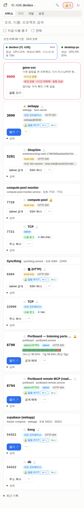

# UI languages: English and Korean

Portboard's dashboard, the text its server writes and the Mac app come in English and Korean. Every word a person
reads comes from one catalog per language; nothing needs a build step or a dependency.

## Which language

| What | Language |
|---|---|
| A page in a browser | **Settings › Display › Language** on this device (Auto · 한국어 · English, kept in `localStorage pb.locale`). Auto follows the server's `locale` when it is set, else the browser's language (`navigator.languages`), else the server's default, English |
| The page's first paint | The server renders each page in its own locale. `lib/shell-boot.js`, inlined in `<head>`, picks the device's language before anything paints and relabels the server-rendered markup in it (after the sidebar and again at the end of the body), so a device set to another language never flashes the server's |
| Text the server writes into an answer the page reads (errors, the setup checklist, suggestions, access reasons) | The page's language: shell-boot keeps it in the `pb_locale` cookie and the server runs each dashboard request in it |
| Text the server sends on its own: ntfy/webhook alerts, digests, new-port and memory notices, MCP prompts and messages, the remote consent page | The server's locale: `PORTBOARD_LOCALE`, else `locale` in `portboard.json` ([config.md](../config.md)), else `en` |
| The Mac app (menu bar, settings window, notifications) | The system language: Korean on a Korean Mac, English otherwise ([mac-app](../mac-app/README.md)) |

Changing the language in Settings reloads the page. MCP tool descriptions stay English: they are read by the model.

Set `locale` (or `PORTBOARD_LOCALE`) to keep an install's alerts, MCP text and pages in one language; a device can still pick its own.

## Screenshots

The same example data in both languages, replayed against a preview:

| English | 한국어 |
|---|---|
|  |  |
|  |  |
|  |  |
|  |  |
|  |  |

## Where the text lives

- **`public/i18n/en.json`, `public/i18n/ko.json`**: flat objects, dotted keys (`ports.menu.rename`), sorted. A value
  is a string with `{name}` placeholders, or `{ "one": …, "other": … }` for a count (picked by `Intl.PluralRules` on
  `params.n`; Korean needs only a string). Catalog text may carry `<b>`, `<code>`, `<kbd>`, `<em>`, `<strong>`.
- **`public/lib/i18n.js`** (pages): `t(key, params)` → text; `tn(key, params)` → nodes, the catalog's markup as
  elements and node params (a link, a button) at their `{name}`; `locale()`. The catalog loads before any module that
  imports it runs (top-level `await`), so `t()` is synchronous.
- **`src/core/i18n.ts`** (server): the same catalogs and format, `t(key, params, locale?)`, `withLocale()`,
  `requestLocale()`. Text is built when it is sent, never at import.
- **Static markup** (`public/*.html`, `src/core/shell.ts`): `data-t="key"` on an empty element fills its text,
  `data-th` its markup, `data-t-title` / `-aria-label` / `-placeholder` / `-label` an attribute. The server fills them
  in its locale (`fillStrings`); the `shell.`, `page.`, `boot.` and `common.` keys are inlined for shell-boot to
  relabel with.
- **Times** (`public/lib/time.js`): `time.*` keys, "5분 전" / "5m ago".
- **The Mac app**: `mac-app/Resources/{en,ko}.lproj/Localizable.strings`, read by `PortboardCore/L10n.swift`; it reuses
  the web keys where the meaning is the same.

## Adding or changing text

1. Use a literal key at the call site: `t('ports.menu.rename')`. Never build one from parts (`t(\`x.${y}\`)`); for an
   enum keep a literal map `{ system: 'ports.kind.system', … }`.
2. Add the key to **both** catalogs with the same placeholders. Write English that reads naturally and Korean that
   reads naturally; follow the meaning, not the word order of the other.
3. `npm test` checks it:
   - `test/i18n.test.ts`: both catalogs hold the same keys, placeholders and plural forms; every key the code uses
     exists; every catalog key is used; the web and server formatters agree; the language is chosen as above; every
     page is fully filled in both locales.
   - `test/i18n-hangul.test.ts`: no Korean in `public/` or `src/` outside comments and `ko.json` (the language
     name 한국어 in `en.json` and a short allow-list, each with its reason, are the exceptions).
   - `test/macapp.test.ts`: the same for the Mac app's strings files.

The tests run in Korean (`PORTBOARD_LOCALE=ko` in `npm test`), so the existing assertions check that production's
text is unchanged; the i18n tests cover English.
